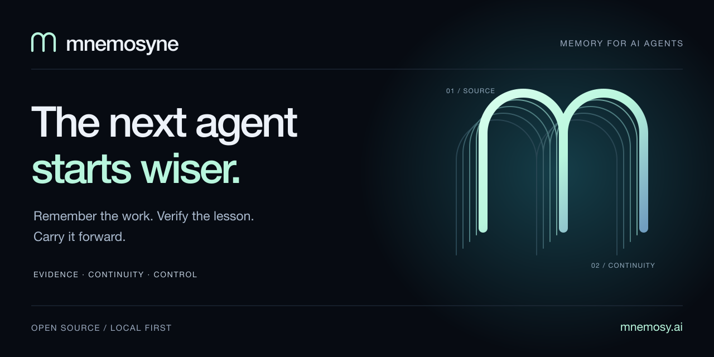
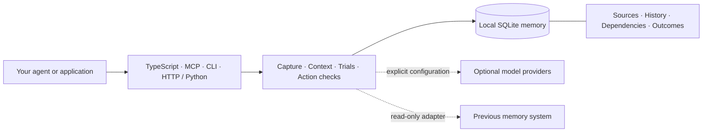

[](https://mnemosy.ai)

# Mnemosyne

[](https://github.com/28naem-del/mnemosyne/actions/workflows/ci.yml)
[](https://www.npmjs.com/package/mnemosy-ai/v/2.0.0)
[](LICENSE)

**The next agent starts wiser.**

**Auditable memory for agents that act. Past beliefs replay exactly, corrections cascade through recorded dependencies, and consolidation is outcome-gated and reversible.**

**Mnemosyne is local-first, long-term memory for AI agents: one SQLite file that keeps what an agent learned together with the evidence it came from, served to any host over TypeScript, MCP, CLI or HTTP.** When a source is corrected, every memory that depended on it is retired, so the next agent starts from what is still true instead of repeating a stale lesson.

Mnemosyne connects memory to its consequences: a corrected requirement can retire a dependent procedure, a failed trial can withhold a skill, and a new agent can resume from an explicit handoff. Run the local engine in one SQLite file; connect your host through TypeScript, MCP, CLI, or authenticated HTTP with a Python client and live inspector.

**2.0.0 · Stable release · MIT · Node.js ≥22.16**

[Website](https://mnemosy.ai) · [Quickstart](docs/quickstart.md) · [Documentation](docs/README.md) · [Examples](examples/README.md) · [Migration](docs/BRIDGE.md) · [Measured results](docs/evaluation/BENCHMARKS.md) · [Trust evidence](docs/BENCHMARKS-TRUST.md) · [npm](https://www.npmjs.com/package/mnemosy-ai/v/2.0.0) · [Contributing](CONTRIBUTING.md)

## New in 3.0.0 (release candidate in this source tree, not yet on npm)

The 3.0.0 line is built and measured in this repository, but it is not published: `npm install mnemosy-ai` still installs 2.0.0. Every number below was measured offline, with no API key, no paid model and no LLM judge. Each one reproduces with the commands in [Benchmarks and trust evidence](docs/BENCHMARKS-TRUST.md), which also lists what is not claimed.

- **Precision you can switch on.** The new opt-in controls are a names gate and guarded single-edit fuzzy matching. Empty answers are native abstentions, and the ledger records why. With the controls on, the kernel scores **70/77 single-turn cases and 11/12 session turns on PrecisionMemBench** (session was 6/12 before). That run was protocol-exact, in retrieval mode, with no LLM judge, no wrapper-side filter and no wrapper `kinds` predicate, and the lexical and hybrid paths score the same. The 12th session turn needs an open-question kind policy that the kernel is not told about.
  - For comparison, the kernel scored 22/77 unfiltered and 48/77 with the fixture-tuned wrapper filters of rc.1.
  - The benchmark fixture is public, and the controls were designed against it, so this is not a held-out estimate.
  - The 7 remaining cases need lifecycle fields that the single-turn protocol does not send.
  - The default retrieval path is unchanged: LoCoMo and LongMemEval-S recall are identical before and after.
- **Consolidation that has to earn its keep.** A consolidation pass is a signed diff, replayed against the agent's own recorded outcomes. It is kept only when nothing regresses and no invariant breaks, and one command undoes it, back to the identical state hash. With consolidation on, the poisoning suite v1 run (227 synthetic cases, reproducible) has **zero escapes: 0 of 167 attacks escaped and 0 of 60 benign controls were falsely quarantined**, across 294 gate decisions. An ungated control lets 85 of the 167 attacks through. [Consolidation gate](docs/CONSOLIDATION.md) · [Signing and receipts](docs/CONSOLIDATION-SIGNING.md)
- **Corrections that reach what nobody linked.** Dependencies are inferred from successful co-use and proposed for review. Once accepted, they are declared through `correct()`, and runtime skills can be linked to their premises. The measurement is on a synthetic seeded corpus (dependency suite v1, seed 20261028, 120 corrections):
  - invalidation recall is **96.05 %**;
  - precision of accepted edges is **98.06 %**;
  - **0** stale procedures ran through the premise guard. That zero comes from the guard, a blanket hold on anything co-used with a changed premise: inference alone leaves 7 of 248 checks stale, and the guard's false-hold rate is 92.78 %.

  [Inferred dependencies](docs/DEPENDENCIES.md)
- **A demo that measures itself.** `mnemosy demo` walks through five moments on synthetic corpora, offline, on the zero-model lexical path:
  1. a past belief replayed exactly;
  2. a correction reaching dependents nobody linked;
  3. `bisect` naming the record that caused a wrong answer;
  4. a poisoning attempt caught, with the suite run live;
  5. a consolidation kept, another rolled back, and the kept one undone.

  Each moment prints a PROOF line measured in that run. [What each moment proves](docs/DEMO.md)

```sh
npm run build
node dist/cli/index.js demo             # five moments, offline, each PROOF line measured live
node dist/cli/index.js demo --classic   # the previous single-scenario demo
```

3.0 is a breaking release: the legacy vector engine moves to `mnemosy-ai-legacy` ([3.0 migration](docs/MIGRATION-v3.md)). The draft release notes are in the [changelog](CHANGELOG.md).

## Install and connect an agent

```sh
npm install mnemosy-ai                   # latest = 2.0.0; pin mnemosy-ai@2.0.0 to reproduce
npx --no-install mnemosy demo            # offline: no API key, no server, no Docker
```

Give the memory to an MCP client. **Claude Code** reads `.mcp.json` in the project root and **Cursor** reads `.cursor/mcp.json`; both take the same server entry. The database file (mode `0600`) and its parent directory (mode `0700`) are created on first use. Relative paths resolve from the directory the client starts the server in; use absolute paths if your client launches servers elsewhere.

```json
{
  "mcpServers": {
    "mnemosyne": {
      "command": "npx",
      "args": [
        "-y", "-p", "mnemosy-ai@2.0.0", "mnemosy", "mcp",
        "--db", "./.mnemosyne/memory.sqlite",
        "--workspace", "my-project", "--agent", "assistant"
      ]
    }
  }
}
```

Claude Code can register the same server from the shell:

```sh
claude mcp add mnemosyne -- npx -y -p mnemosy-ai@2.0.0 mnemosy mcp --db ./.mnemosyne/memory.sqlite --workspace my-project --agent assistant
```

The server exposes 16 `memory_*` tools (`memory_store`, `memory_recall`, `memory_context`, `memory_correct`, `memory_checkpoint`, `memory_resume`, `memory_observe`, `memory_skill`, …); `memory_forget` is added only when the server is launched with `--allow-destructive`. Add `--read-only` to omit every mutation tool. A model cannot switch workspace, raise its own trust or report its own skill trials through MCP. Agent-readable summaries of this repository are in [`llms.txt`](llms.txt) and [`AGENTS.md`](AGENTS.md); the full MCP contract is in [Connect through MCP](#connect-through-mcp).

## Measured: 409 of 500 on LongMemEval-S, with the misses printed

| What | Result | How it was measured |
|---|---|---|
| **Answer accuracy**, LongMemEval-S, all 500 questions | **409 / 500 correct (81.8%)**, Wilson 95% CI 78.2–84.9; exact match 7.6% | Mnemosyne reranked retrieval, top-20 hits packed to 16 KB, read by `claude-sonnet-4.6`, judged by `claude-haiku-4.5`. Prompt and budget were chosen on 100 of the questions; the other 400 score 82.3%. |
| **Reranker gain**, LoCoMo, 1,531 annotated questions | MRR@10 0.461 → 0.624, **+0.163** (paired bootstrap 95% CI 0.146–0.181; 599 wins, 133 losses) | The same hybrid candidate set with and without the bundled cross-encoder, on the shipped build. |
| **Against Mem0 OSS**, same corpus, chunks, K, packing budget, scorer, one process | LoCoMo recall@10 **73.57 vs 63.72** with reranking; our *unreranked* path **loses to Mem0 at every K**; on LongMemEval-S the two tie on recall@20 and Mem0 takes MRR | [COMPARISON.md](COMPARISON.md), every loss in the same tables |

**What these numbers do not say.** The 81.8% is not a paired gain over the earlier 71.2%: that baseline used a different 250-question sample, prompt and budget, so the improvement belongs to the whole bundle of changes. The reader is nondeterministic; rerunning one configuration moved its score by about a point. Retrieval numbers measure coverage, not answers. Two Tier 1 targets of this release are **not met** and ship disclosed: recall latency at one million records is p95 139–223 ms against a 50 ms goal (opt-in `indexMode: 'hnsw'`, see [Tune the dense index](#tune-the-dense-index)), and contextual reranking ships at 71.98% all-evidence hit against a 72.80% gate, 0.82 points (13 of 1,531 questions) short; the best variant tried was still four short and was not merged. Commands and raw outputs are in [`reports/t1-targets/evidence/`](reports/t1-targets/evidence/) the answer-accuracy and gate results are restated with their commits in the [changelog](CHANGELOG.md), and the Mem0 and reranker retrieval tables are in [COMPARISON.md](COMPARISON.md).

## Choose your engine

**Both engines ship in 2.0.0.** Choose the storage and runtime that fit your application:

| Engine | Best starting point | SDK entry point | Guide |
|---|---|---|---|
| **Vector Engine** | An application using the existing service-backed memory architecture. Requires configured external services. | `createMnemosyne` from `mnemosy-ai` 2.x; from 3.0 in the separate `mnemosy-ai-legacy` package | [Working example](packages/legacy/examples/basic-usage.ts) · [Version 2 changes](docs/MIGRATION-v2.md) · [3.0 split](docs/MIGRATION-v3.md) |
| **Local Engine** | A self-contained SQLite memory store with evidence, corrections and agent lifecycle tools. | `createLocalMemory` from `mnemosy-ai/local` | [Local API](docs/api.md) · [Agent lifecycle](docs/AGENT.md) |

The `MemoryAgent` adapter uses the Local Engine's runtime. These engines have separate schemas and do not automatically migrate or synchronize data. To transition gradually, explicitly connect your existing store through the [read-only migration bridge](docs/BRIDGE.md); it leaves that store unchanged.

Engine choice is separate from version: `mnemosy-ai@latest` is 2.0.0 and contains **both** engines; the 1.x line stays installable as `mnemosy-ai@1`. **Upgrading from 1.x is a breaking change**: read the [migration notes](docs/MIGRATION-v2.md) before upgrading an existing Vector Engine application. In this source tree, prepared for 3.0.0, the Vector Engine has moved out of `mnemosy-ai` into the unpublished [`mnemosy-ai-legacy`](packages/legacy/README.md) package; see the [3.0 migration notes](docs/MIGRATION-v3.md).

## Start with a working demonstration

Install the package in your project. Node 24 is recommended; the local memory engine needs no model API key, database server, or Docker.

```sh
npm install mnemosy-ai
npx --no-install mnemosy demo
npx --no-install mnemosy learning-demo
```

Unqualified `npm install mnemosy-ai` follows the `latest` channel, which is 2.0.0 from 27 October 2026; pin `mnemosy-ai@2.0.0` for reproducible deployments. If you are upgrading from the 1.x line, read the [migration notes](docs/MIGRATION-v2.md) first: version 2 changes vector retrieval scoring, startup indexing and erasure, and does not migrate an existing database. Evaluate on your own workload before production. Python registry publication is separate; the bundled Python client can be installed from the checkout.

To build and run the same release from source:

```sh
git clone --branch v2.0.0 --depth 1 https://github.com/28naem-del/mnemosyne.git
cd mnemosyne
npm ci --ignore-scripts
npm run build
npm run demo
npm run demo:learning
```

In 2.0.0, the first demo uses a temporary database to show a handoff, correction, private scope and forgetting. In this source tree (3.0.0 draft), `mnemosy demo` is the [five-moment demo](docs/DEMO.md) and the 2.0.0 demo is `mnemosy demo --classic`. The learning demo exercises capture, a scripted observation job, skill trials, explicit sharing and correction-driven retirement. Both run real local APIs with deterministic fixtures and no model calls. [Choose your next example](examples/README.md).

For full contributor validation, run `npm run check`, `npm run check:docs` and `npm run check:public`. 2.0.0 is the 2.0.0-rc.10 candidate promoted to stable with no source change (one dependency security patch, `zod` 4.6.2 → 4.6.7, is noted in the changelog); it carries the Tier 1 retrieval work (hybrid default, cross-encoder reranking, opt-in dense index and temporal routing) over the RC9 packaging. The recorded evaluation reports remain historical measurements of the versions and conditions they name.

To consume your built checkout from another project, run `npm install /absolute/path/to/mnemosyne` in that project. Keep the checkout and its `dist` directory available. The older [RC8 GitHub release and checksummed downloads](https://github.com/28naem-del/mnemosyne/releases/tag/v2.0.0-rc.8) remain unchanged.

## A correction should change what the next agent does

```js
import { createLocalMemory } from 'mnemosy-ai/local';

const memory = createLocalMemory({
  path: './agent-memory.sqlite',
  workspaceId: 'catalogue',
  agentId: 'designer',
});

const brief = memory.store({
  text: 'Product images must be 1200 by 900 pixels.',
  kind: 'fact',
  key: 'catalogue.image-size',
  source: { uri: 'brief://catalogue/v1' },
  trust: 'observed',
  visibility: 'workspace',
});

const procedure = memory.store({
  text: 'Export catalogue product images at 1200 by 900 pixels.',
  kind: 'procedure',
  source: { uri: 'run://designer/export' },
  trust: 'observed',
  dependencies: [brief.id],
  visibility: 'workspace',
});

memory.correct(brief.id, {
  text: 'Product images must be 1600 by 1200 pixels.',
  source: { uri: 'brief://catalogue/v2' },
  reason: 'The delivery specification changed.',
});

console.log(memory.get(procedure.id)?.status); // invalidated
const context = memory.compile({
  query: 'catalogue product images',
  maxTokens: 2048,
});
console.log(context.text); // Send eligible context to your responder.
// Inspect context.citations and context.uncertainty alongside the text.
memory.close();
```

The old procedure remains inspectable but is no longer eligible as current guidance. Dependencies are declared by the controller. In 3.0, the [dependencies module](docs/DEPENDENCIES.md) can also propose undeclared dependencies from successful co-use, and a reviewer accepts or rejects each one. `observed` means the host recorded the source; it does not certify its truth. The default context counter measures UTF-8 bytes conservatively, not a model's tokenizer. [Context contract](docs/CONTEXT.md).

## Tune the dense index

Recall works without any of this. These three options exist for stores large enough that the
defaults stop being the right trade, and all three are opt-in.

```js
const memory = createLocalMemory({
  path: './agent-memory.sqlite',
  workspaceId: 'catalogue',
  agentId: 'designer',

  indexMode: 'hnsw',            // 'exact' | 'auto' (default) | 'sqlite-vec' | 'hnsw'
  sqliteVecPath: '/opt/lib/vec0.dylib',  // explicit extension path; no env-var equivalent
  cacheSize: -65536,            // PRAGMA cache_size: negative = KiB, positive = pages
});
```

**`indexMode`** — which dense index to search. Defaults to `$MNEMOSYNE_INDEX_MODE`, else `auto`.

| mode | what it does |
|------|--------------|
| `exact` | Scores every authorized vector. No optional binaries, no index files, and the answer every other mode is measured against. |
| `auto` *(default)* | sqlite-vec when the extension loads, otherwise `exact`. Still an exact search — `vec0` scores the same vectors in C instead of in JS. |
| `sqlite-vec` | As `auto`, but **throws** instead of degrading silently when the extension is unavailable. |
| `hnsw` | Approximate and sublinear, for stores past a few hundred thousand vectors. The one retrieval component here that can *miss* a true neighbour — which is why it is **never selected on your behalf**. Its 50 ms p95 target at 1M records is not met: 139–223 ms measured (see [CHANGELOG](CHANGELOG.md)). |

Asking explicitly for `sqlite-vec` or `hnsw` and not getting it is an error, not a downgrade: those
two modes throw when the backend is unavailable. `auto` is the only mode that degrades, and it only
ever degrades to an exact search, never to an approximate one.

No mode changes what a record scores or whether it may be returned. Every candidate an index
proposes is re-authorized and rescored against the stored vector before it reaches you, so the index
is a shortlist, never an authority.

**`sqliteVecPath`** — an explicit filesystem path to a `sqlite-vec` loadable extension, overriding
the bundled package's own resolution. Only consulted when `indexMode` is `auto` or `sqlite-vec`.

There is deliberately **no environment-variable equivalent.** An env-controlled path would make
every `LocalMemory` opened on the machine `dlopen` whatever that variable pointed at, by default and
without the caller asking. Loading a native extension is a decision the calling code has to make in
the open, so it lives in the constructor and nowhere else.

**`cacheSize`** — `PRAGMA cache_size`, applied on every open, in SQLite's own units: a **positive**
value is a page count, a **negative** value is a KiB budget. Defaults to `-65536` (64 MiB), and a
negative value is the recommended form since page size can vary. Must be a nonzero integer of
magnitude at most 2,097,152.

A larger page cache buys fewer trips through the OS page cache for the shortlist rescore and the
BM25 postings that the hot recall path reads on every query. It matters once the working set stops
fitting in the few megabytes SQLite would otherwise settle for on its own — and it is a real memory
cost, charged per open connection, so it is set rather than guessed.

## What you can build

| Capability | Behavior | Developer guide |
|---|---|---|
| **Memory with evidence** | Private-by-default records, explicit sharing, corrections, conflicts, source history and dependent retirement. | [Local API](docs/api.md) |
| **Continuity across agents** | Structured checkpoints preserve goals, decisions, artifacts and next actions; source changes can retire obsolete handoffs. | [Agent lifecycle](docs/AGENT.md) |
| **Adaptive context** | Budgeted observations, hierarchical summaries and expandable original source bytes, with evidence revalidation. | [Context](docs/CONTEXT.md) |
| **Recall across words and meaning** | Scoped BM25 by default; optional embeddings, hybrid fusion and reranking over authorized records. | [Local semantic retrieval](docs/LOCAL-MODELS.md) |
| **Memory across time** | Separate `asOf` and `knownAt` queries, scheduled corrections and causal invalidation history. | [Runtime](docs/RUNTIME.md) |
| **Evidence-gated skills** | Candidate procedures, explicit trial requirements and retirement after failed or changed evidence. | [Skills and trials](docs/RUNTIME.md#project-models-skill-trials-and-traces) |
| **Source-backed profiles** | Typed fields report supported values, unknowns or conflicts and revalidate their inputs. | [Profiles](docs/PROFILES.md) |
| **Silent-staleness checks** | Explicit source policies, last-confirmed evidence, bounded probes and action-bound dependency checks. | [Freshness](docs/MAINTENANCE.md) |
| **A controlled transition** | Read-only access to your previous store, gradual local preference, reconciliation and routing rollback. | [Gradual migration](docs/BRIDGE.md) |
| **Full import and recovery** | Eleven export profiles, preview, atomic application, replay protection, guarded undo and whole-database backups. | [Import](docs/MIGRATION.md) · [Recovery](docs/OPERATIONS.md) |
| **Host-controlled processing** | Durable bounded jobs, source-backed project models, outcome traces, entity relations and staged changes. | [Runtime](docs/RUNTIME.md) |

## Local Engine, several entry points



The host chooses identities, trust assertions, providers and execution budgets. Construction starts no worker or model download. `MemoryAgent` can prepare context before a turn and capture supplied visible input/output afterward; background work runs only when the host starts it. [Host loop](docs/AGENT.md).

The local database holds memories, vectors and runtime state. Optional local CPU providers run cached inference in separate processes after explicit provisioning. Their dependency requirements, model identities and licenses are documented in the [local model guide](docs/LOCAL-MODELS.md). The existing backend integration remains available through `createMnemosyne` (in `mnemosy-ai-legacy` from 3.0); it does not automatically synchronize with the local engine. [Version 1 migration notes](docs/MIGRATION-v2.md).

### Connect through MCP

With the npm package, use the `npx` entry shown in [Install and connect an agent](#install-and-connect-an-agent). From a source checkout, point the client at the built CLI instead; the database's parent directory is created on first use.

```json
{
  "command": "node",
  "args": [
    "/absolute/path/mnemosyne/dist/cli/index.js", "mcp",
    "--db", "/absolute/path/data/memory.sqlite",
    "--workspace", "my-project", "--agent", "assistant"
  ]
}
```

Use `--read-only` to omit mutation tools. Forgetting requires an explicit `--allow-destructive` launch. Models cannot choose another workspace, promote their own trust, or report successful trials through MCP. For an authenticated service, Python access and a live inspector, see [HTTP and Python](docs/RUNTIME.md#http-inspector-and-python). Native provider tool protocols are documented in the [adapter guide](docs/PROVIDER-TOOLS.md).

### Require stronger skill evidence

```js
import { createLocalMemory } from 'mnemosy-ai/local';
import {
  MemoryRuntime,
  RECOMMENDED_SKILL_PROMOTION_POLICY,
} from 'mnemosy-ai/runtime';

const memory = createLocalMemory({
  path: './skills-memory.sqlite', workspaceId: 'my-project', agentId: 'assistant',
});
const runtime = new MemoryRuntime(memory, {
  skillPromotionPolicy: RECOMMENDED_SKILL_PROMOTION_POLICY,
});
// Use runtime to create candidates and record controller trials.
memory.close(); // Close after your host finishes using the runtime.
```

The recommended policy requires successful trials across two distinct tasks and two verifier identities. Candidates stay outside advisory context until their stored requirements are satisfied; a weaker configuration cannot lower an existing candidate's requirements. The compatibility default remains one task and one verifier. Identities and trial outcomes are controller assertions, so your host must provide real tests and independent evidence. [Trial contract](docs/RUNTIME.md#project-models-skill-trials-and-traces).

## Migrate while your agent keeps working

The optional `mnemosy-ai/bridge` wraps your explicitly supplied legacy search adapter. It copies used records with stable origins, compares paired retrieval results, and moves from shadow to assist to preferred routing as observed coverage meets configured thresholds. Missing legacy matches remain available, and routing can return to the previous system.

The bridge keeps querying the original store for reconciliation and never writes or deletes there. Progress measures observed queries, not complete-store migration or answer quality. Host credentials, source selection and eventual cutover stay under your control. [Bridge contract](docs/BRIDGE.md).

For a full export migration, choose one of the eleven supported profiles, preview the exact source bytes, then apply the reviewed plan atomically. Imports are private and untrusted by default; retry recognition, source inspection, guarded undo and erasure replay protection are included. Foreign embeddings and unsupported policy semantics are not silently converted. [Full migration](docs/MIGRATION.md).

```sh
node --experimental-strip-types examples/gradual-migration.ts
node --experimental-strip-types examples/migration.ts
node --experimental-strip-types examples/maintenance.ts
```

These examples use isolated synthetic data. They do not connect to your existing accounts or memory stores.

## Measured, with the limits visible

The paired LongMemEval S retrieval run includes all **500 questions**, with positive evidence metrics on **470 annotated answerable questions**. Both retrieval conditions use 20 chunks and the same 8,192-byte context budget.

| Complete annotated-session coverage | Earlier overlap scorer | Current BM25 default |
|---|---:|---:|
| Before context packing | 386 / 470 (82.13%) | 425 / 470 (90.43%) |
| After context packing | 367 / 470 (78.09%) | 382 / 470 (81.28%) |

The 30 abstention questions remain in attempt counts without a positive retrieval score. All 500 full-history controls exceeded the context budget and are reported as overflows. The run uses same-day timestamp compatibility, including 1,475 sessions later than the stated question instant. A session hit can come from any of its chunks; it does not prove that the answer-bearing sentence reached the model. No embedding, generation or judge calls were made.

These results measure retrieval coverage against the earlier local scorer. They do not establish generated-answer accuracy or superiority over other systems. [Raw reports and fingerprints](docs/evaluation/BENCHMARKS.md) · [Reproduction protocol](docs/evaluation/CORPUS_PROTOCOL.md).

### Against another memory system

A **matched competitor benchmark** against Mem0 OSS is published in **[COMPARISON.md](COMPARISON.md)** — same corpus, same chunks, same K, same packing budget, all scored inside one process, with the results where Mem0 beats us printed in the same tables as the results where it does not. In short: our reranked path takes the LoCoMo headline at 73.57 recall@10 against Mem0's 63.72, our *unreranked* hybrid loses to Mem0 at every K on both recall and MRR, and on LongMemEval-S the two tie on recall@20 while Mem0 takes MRR. Zep and Graphiti carry a reason rather than a number: neither could be run without paid credentials. These are retrieval-coverage numbers with no reader and no judge, not answer accuracy.

A separate [evidence lifecycle diagnostic](docs/evaluation/EVIDENCE-PROTOCOL.md) tests correction, time, conflicts, failure, erasure and scope behavior. It deliberately retains a failing case: changing an unrelated field can retire a still-valid dependent rule. The [engineering review](docs/EXTERNAL-REVIEW.md) and [release status](docs/UPGRADE-STATUS.md) track this and other remaining work.

## Operational boundaries

Workspace and agent IDs are trusted controller selectors, not tenant authentication. The HTTP service supplies scope-bound bearer authentication; remote TLS and enterprise identity require application deployment work. Databases and backups are plaintext. Forgetting removes covered live content and blocks known source replays, but cannot erase an older backup or a prompt already sent to a model.

Local semantic search scans the eligible indexed corpus with bounded retained candidates and a deadline. That exact scan is the default; an approximate index is available but opt-in and never selected on your behalf (see [Tune the dense index](#tune-the-dense-index)), and every candidate any index proposes is re-authorized and rescored against the stored vector before it is returned. Generated observations and trial results remain fallible assertions. Action checks validate declared local dependencies before dispatch, not external transactions. Managed synchronization, model training and six validated native framework integrations are not included. [Security](SECURITY.md) · [Deployment](docs/deployment.md) · [Backup and restore](docs/OPERATIONS.md).

## Build with us

Mnemosyne is built by **Aristotle Intelligence Inc., a Delaware company**, and has been **fully self-funded to date**. For advanced memory requirements, integration discussions or investor enquiries, contact **[28naem@gmail.com](mailto:28naem@gmail.com)**.

Use [GitHub issues](https://github.com/28naem-del/mnemosyne/issues) for reproducible bugs and feature proposals. Report vulnerabilities privately through [SECURITY.md](SECURITY.md). Contributions that improve evidence retention, integration reliability or reproducible evaluation are especially useful.

[Contributing](CONTRIBUTING.md) · [Architecture](ARCHITECTURE.md) · [Changelog](CHANGELOG.md) · [Code of conduct](CODE_OF_CONDUCT.md) · [MIT license](LICENSE) · [Third-party notices](NOTICE.md)
